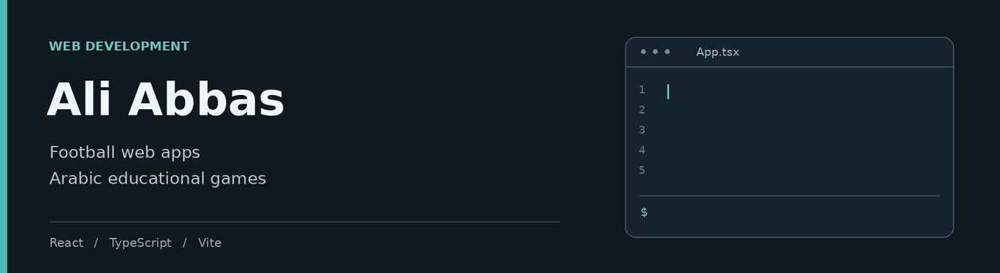

 

I build football web apps, Arabic educational games and university tools with React and TypeScript.

## Projects

<table>
<tr>
<td width="50%" valign="top">
<h3><a href="https://github.com/ali672006ali-prog/karpatsof-sport">Karpatsof Sport</a></h3>

Arabic football dashboard with scores, standings, lineups and match statistics.

<code>React</code> <code>TypeScript</code> <code>Vite</code>

</td>
<td width="50%" valign="top">
<h3><a href="https://github.com/ali672006ali-prog/football2">Football 2</a></h3>

Football scores, standings, top scorers and tournament views, with an Express server.

<code>React</code> <code>TypeScript</code> <code>Express</code>

</td>
</tr>
<tr>
<td width="50%" valign="top">
<h3><a href="https://github.com/ali672006ali-prog/AbleMath">AbleMath</a></h3>

Arabic math game for fourth-grade special education students. Practice the number 100 and counting by tens.

<code>React 19</code> <code>Tailwind CSS</code> <code>Motion</code>

</td>
<td width="50%" valign="top">
<h3><a href="https://github.com/ali672006ali-prog/football">Football</a></h3>

My original football project repository. It currently contains a README, with links to the application repositories.

<code>Early project</code>

</td>
</tr>
<tr>
<td width="50%" valign="top">
<h3><a href="https://github.com/ali672006ali-prog/UMind---Smart-University-Assistant-">UniMind - Smart University Assistant</a></h3>

Productivity suite for university students: an AI study partner, planner, Pomodoro timer, tasks and GPA tracker.

<code>React</code> <code>TypeScript</code> <code>Gemini API</code>

</td>
<td width="50%" valign="top">
<h3><a href="https://github.com/ali672006ali-prog/ADHD-Screening-Test">ADHD Screening Test</a></h3>

Digital ADHD self-assessment scale with instant scoring and bilingual diagnostic reports. Built for Menoufia University.

<code>React</code> <code>TypeScript</code> <code>Gemini API</code>

</td>
</tr>
<tr>
<td width="50%" valign="top">
<h3><a href="https://github.com/ali672006ali-prog/childrens-iq-test">Children's IQ Test</a></h3>

Clinical platform for administering and scoring a children's IQ test, with AI-assisted bilingual diagnostic reports. Menoufia University.

<code>React</code> <code>TypeScript</code> <code>Firebase</code> <code>Gemini API</code>

</td>
<td width="50%" valign="top"></td>
</tr>
</table>

## Stack

<code>React</code> &nbsp; <code>TypeScript</code> &nbsp; <code>Vite</code> &nbsp; <code>Tailwind CSS</code> &nbsp; <code>Express</code> &nbsp; <code>Motion</code> &nbsp; <code>Firebase</code> &nbsp; <code>Gemini API</code>
